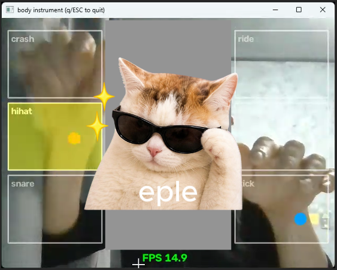
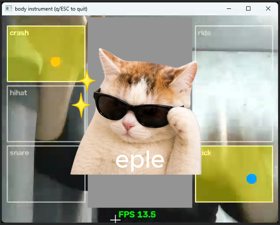
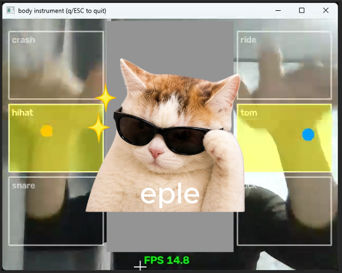

# YOLO-Beat

YOLO와 음악의 비트(Beat)를 합친 이름이에요. 시각 모델이 음악적 리듬과 상호작용해요.

노트북 웹캠 앞에서 손을 휘둘러 화면의 드럼 패드를 치면 소리가 나는 앱이에요.
[Ultralytics YOLO](https://github.com/ultralytics/ultralytics)의 Pose 모델로 손목 위치를 찾고,
손목이 패드에 들어가는 순간 드럼 소리를 재생해요.

- 패드 6개: 왼쪽 열은 crash / hihat / snare, 오른쪽 열은 ride / tom / kick (가운데는 비워 둬서 몸이 닿아도 울리지 않아요)
- 드럼 소리는 numpy로 직접 합성해요. 샘플 파일이 필요 없어요
- GPU 없이 CPU만으로 동작해요. Intel i5-1035G7 노트북에서 입력 크기 320 기준으로 약 11~17 FPS가 나왔어요

## 실행 화면

손목(점)이 들어간 패드가 노랗게 깜빡이면서 소리가 나요.

| hihat + kick | crash + kick | hihat + tom |
|---|---|---|
|  |  |  |

### 시험 영상

<video src="docs/videos/YOLO-Beat-test.mp4" controls width="640"></video>

영상이 위에서 재생되지 않으면 [여기(YOLO-Beat-test.mp4, 8.5MB)](docs/videos/YOLO-Beat-test.mp4)를 눌러 주세요.

## 준비물

- [uv](https://docs.astral.sh/uv/) (Python 3.14는 uv가 자동으로 준비해요)
- 웹캠, 스피커 또는 이어폰
- 첫 실행 때 인터넷 연결 (모델 다운로드)

## 설치

```bash
uv sync
```

PyTorch(CPU 버전)를 포함해서 다운로드 용량이 수백 MB 정도예요.

## 실행

```bash
uv run python -m yolo_beat.app
```

- 종료: 창에서 `q` 또는 `ESC`, 또는 창의 닫기(X) 버튼
- 옵션
  - `--imgsz 320`: 모델 입력 크기예요. 작을수록 빠르고 덜 정확해요 (기본값 320)
  - `--mute`: 소리 없이 판정만 해요
  - `--seconds 10`: 10초 뒤 자동으로 종료해요

몸 전체보다 **상반신과 양손이 화면에 들어오게** 앉으면 잘 돼요.
치는 기록은 터미널에 `시간  HIT 패드 by 손  직전 타격과의 간격` 형태로 찍혀요.

손목 인식과 FPS만 확인하려면 이렇게 실행해요.

```bash
uv run python -m yolo_beat.pose_preview
```

## 모델 파일

모델(`yolo11n-pose.pt`, 약 6MB)은 저장소에 넣지 않았어요.
**처음 실행할 때 `models/` 폴더로 자동으로 받아져요.**
출처는 Ultralytics 공식 릴리스예요:
`https://github.com/ultralytics/assets/releases/download/v8.4.0/yolo11n-pose.pt`

## 테스트

```bash
uv run pytest
```

구역 판정(경계, 진입, 쿨다운, 감지 끊김 유예)과 합성 소리(길이, 음량, 클리핑), 손 좌우 표시를 검사해요.
웹캠과 스피커 없이도 돌아가요.

## 폴더 구조

```
src/yolo_beat/
  app.py           # 메인 앱: 웹캠 → 손목 → 패드 판정 → 소리
  pose_preview.py  # 손목 표시 + FPS 측정 (--bench N)
  zones.py         # 패드 배치와 진입 판정
  sounds.py        # numpy 드럼 합성 + pygame 재생
tests/             # pytest
docs/              # 만든 과정 전체 (아래 참고)
```

## 문서 (docs)

만든 과정을 자세히 적은 문서예요. 목차는 [docs/README.md](docs/README.md)에 있어요.

- [PRD](docs/01-prd.md) · [아키텍처](docs/02-architecture.md) · [폴더 구조](docs/03-folder-structure.md)
- [처음 하는 사람 체크리스트](docs/04-getting-started-checklist.md): Python 버전 호환, uv, 웹캠 백엔드 등 실제로 부딪힌 것
- [개발 일지](docs/05-dev-log.md) · [시험 기록 (기대 → 실제)](docs/06-test-log.md) · [결정 기록](docs/07-decisions.md)

## 라이선스

이 프로젝트는 [Ultralytics YOLO](https://github.com/ultralytics/ultralytics)를 사용해요.
Ultralytics YOLO가 **AGPL-3.0** 라이선스라서, 이 프로젝트도 **AGPL-3.0** 조건을 따라요.
이 프로젝트를 배포하거나 네트워크 서비스로 제공하면 소스도 AGPL-3.0으로 공개해야 해요.

- 라이선스 전문: [LICENSE](LICENSE)
- AGPL-3.0 원문(GNU): <https://www.gnu.org/licenses/agpl-3.0.html>
- Ultralytics 라이선스 안내: <https://www.ultralytics.com/license>

## To. YOLO 개발자분들께

완전 감사합니다. 덕분에 재미있는 프로젝트 했습니다. ^^
