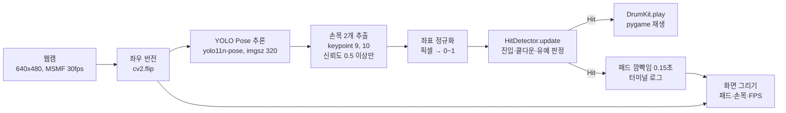
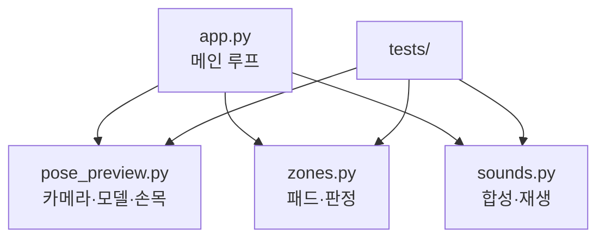
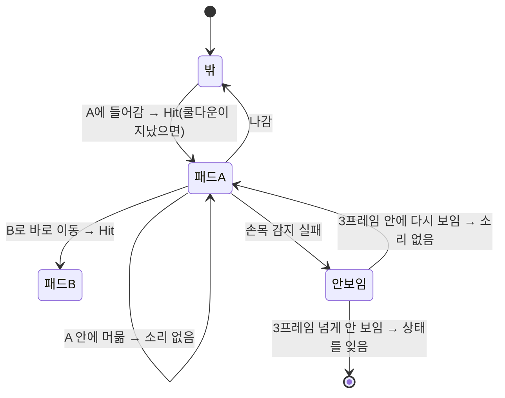

# 02. 아키텍처

> 프레임 하나가 웹캠에서 소리가 되기까지의 흐름, 모듈마다 맡은 일, 판정 규칙, 소리 합성 방식을 적었어요.

## 1. 전체 흐름



한 프레임 처리 순서(`app.py`의 `run()`):

1. `cap.read()`로 프레임을 받는다.
2. `cv2.flip(frame, 1)`로 좌우를 뒤집는다. 사용자가 거울처럼 보게 하려는 것.
3. `model(frame, imgsz=320)`으로 Pose 추론을 한다.
4. `wrists(result)`가 첫 번째 사람의 손목 중 신뢰도 0.5 이상인 것만 `{keypoint 번호: (x, y)}`로 돌려준다.
5. 픽셀 좌표를 화면 크기로 나눠 0~1로 바꾼다.
6. `detector.update(points, now)`가 이번 프레임에 새로 "들어간" 패드 목록(Hit)을 돌려준다.
7. Hit마다 소리를 재생하고, 깜빡임 시간을 기록하고, 로그를 찍는다.
8. 패드, 손목 점, FPS를 그려서 `cv2.imshow`로 보여 준다.

## 2. 모듈 구성



| 모듈 | 맡은 일 | 바깥 의존 | 테스트 |
|---|---|---|---|
| `pose_preview.py` | 카메라 열기(`open_camera`), 모델 로드(`load_model`), 손목 추출(`wrists`), 손 이름(`hand_label`), FPS 벤치(`--bench`) | OpenCV, Ultralytics | `hand_label`만 (나머지는 웹캠 필요) |
| `zones.py` | `Zone`(사각형), `default_drum_layout()`(6패드), `HitDetector`(진입 판정) | 없음 (순수 Python) | 14개 |
| `sounds.py` | 드럼 소리 6개 합성, `to_int16`, `DrumKit`(pygame 재생) | numpy, pygame | 5개 (재생은 제외) |
| `app.py` | 위 셋을 묶은 메인 루프, 화면 그리기, 로그, 종료 처리 | 위 모듈 전부 | 없음 (실기 시험으로 확인) |

**설계 원칙:** 판정과 합성은 **웹캠·스피커 없이 테스트할 수 있는 순수 함수**로 분리했다.
장치가 필요한 부분(`open_camera`, `DrumKit`, `app.run`)은 얇게 두고 실기 시험으로 확인했다.

## 3. 좌표계

- 모든 판정은 **정규화 좌표**를 쓴다. x는 왼쪽 0 → 오른쪽 1, y는 위 0 → 아래 1.
- 해상도가 바뀌어도(640x480이든 1280x720이든) 패드 정의를 고치지 않아도 된다.
- 판정은 **반전된 화면 기준**이다. 사용자 눈에 보이는 위치와 판정 위치가 같다.

### 손 이름(L/R)과 거울 반전

- COCO 키포인트 9번은 left_wrist, 10번은 right_wrist다.
- 하지만 프레임을 **뒤집은 뒤** 모델에 넣기 때문에, 모델이 "왼손목"이라고 하는 점은 실제로는 **사용자의 오른손**이다.
- 그래서 `hand_label(9)`는 `"R"`, `hand_label(10)`은 `"L"`을 돌려준다.
- 이 문제는 실기 시험 1회차 로그에서 발견했다. 화면 오른쪽 패드가 전부 `L`로 찍혔다([06-test-log.md](06-test-log.md) T-12).

## 4. 패드 배치

```
x:   0.02     0.30                0.70     0.98
     +-----------+                +-----------+   y 0.05
     |   crash   |                |   ride    |
     +-----------+                +-----------+   y 0.32
     +-----------+                +-----------+   y 0.34
     |   hihat   |    (empty:     |    tom    |
     +-----------+    face/body)  +-----------+   y 0.61
     +-----------+                +-----------+   y 0.63
     |   snare   |                |   kick    |
     +-----------+                +-----------+   y 0.90
```

> 그림은 영문과 기호만 써서 그렸어요. 한글은 영문보다 폭이 넓어서 코드 블록 안에 섞으면 줄이 어긋나요.
> 가운데 `(empty: face/body)`는 "얼굴과 몸이 있는 가운데는 비워 둠"이라는 뜻이에요.

- 가운데 열(0.30~0.70)을 비운 이유: 얼굴과 몸통이 있는 곳이라 가만히 있어도 울릴 수 있다.
- 패드 사이에 0.02 간격을 뒀다. 경계에서 두 패드가 번갈아 울리는 것을 줄이려는 것.
- `Zone.contains`는 **왼쪽·위 경계는 포함, 오른쪽·아래 경계는 제외**한다. 붙어 있는 두 패드의 공유 경계 위 점은 정확히 한 패드에만 속한다.

## 5. 판정 규칙: `HitDetector`

손목마다 "지금 어느 패드 안에 있는지"와 "몇 프레임째 안 보이는지"를 기억한다.



| 규칙 | 값 | 이유 |
|---|---|---|
| 진입할 때만 Hit | - | 머무는 동안 계속 울리면 연주가 안 된다 |
| 첫 프레임에 이미 안에 있으면 Hit | - | 상태가 없던 손목이 패드 안에서 나타난 것도 "들어간 것"으로 본다 |
| 쿨다운 `cooldown_s` | 0.12초 | 같은 패드는 120ms 안에 다시 울리지 않음. 경계 떨림 방지 |
| 유예 `grace_frames` | 3프레임 | 감지가 잠깐 끊겼다 같은 패드에서 다시 보일 때 재타격으로 치지 않음 |
| 양손이 같은 프레임에 같은 패드 | 1번만 Hit | 쿨다운이 패드 단위라서 두 번째 손은 막힘 |
| 양손이 같은 프레임에 다른 패드 | 2번 Hit | 동시 타격 |

**알려진 한계:** 지금은 "들어갔나"만 본다. 손을 패드 경계에 걸쳐 두면 손목 점이 떨리면서 넘나들어 계속 울릴 수 있다.
실기 시험 2회차에 kick이 3.7초 동안 11번 울린 구간이 이것으로 추정된다(확인 안 됨, T-15).
→ 다음 기능 "치는 동작 판정(속도·통과)"으로 해결할 예정.

## 6. 소리 합성

모든 소리는 float32 배열(-1~1)로 만들고, 재생할 때 int16 스테레오로 바꾼다.
난수 시드를 0으로 고정해서 실행할 때마다 같은 소리가 난다.

| 패드 | 길이 | 만드는 방법 |
|---|---|---|
| kick | 0.45초 | 150Hz → 45Hz로 떨어지는 사인파(피치 스윕) × 감쇠 0.12초 |
| snare | 0.25초 | 185Hz 사인파(몸통, 감쇠 0.04) + 고역 통과한 노이즈(울림, 감쇠 0.06) |
| hihat | 0.08초 | 노이즈를 두 번 미분(더 밝게) × 감쇠 0.015, 음량 0.6 |
| tom | 0.40초 | 140Hz → 95Hz 피치 스윕 × 감쇠 0.12 |
| ride | 0.90초 | 비정수 배음 5개(520, 845, 1310, 2110, 3370Hz) + 노이즈 × 감쇠 0.2, 음량 0.6 |
| crash | 1.40초 | 고역 통과한 노이즈 × 감쇠 0.3, 음량 0.7 |

공통 처리:
- **감쇠 엔벨로프:** `exp(-t / decay)`. 시작은 크고 끝은 작다.
- **2ms 페이드인:** 시작할 때 "딱" 하는 클릭 잡음을 없앤다.
- **고역 통과:** 1차 차분(`np.diff`). 저음을 빼서 노이즈를 금속성으로 만든다.
- **정규화:** 최대 진폭을 0.6~0.9로 맞춘다. 1.0을 넘으면 클리핑(찢어지는 소리)이 난다.

재생(`DrumKit`):
- `pygame.mixer` 44100Hz, 16bit, 스테레오, **버퍼 256 샘플**(약 5.8ms). 버퍼가 작을수록 지연이 줄어든다.
- 채널 16개. 여러 소리가 겹쳐도 앞 소리가 끊기지 않는다.
- `play()` 호출은 0.03ms 이하로 바로 반환된다(T-11). 메인 루프를 막지 않는다.

## 7. 성능 예산 (입력 크기 320 기준)

| 단계 | 시간 | 근거 |
|---|---|---|
| 카메라 프레임 간격 | 약 33ms (30fps) | MSMF 측정 30.0fps (T-05) |
| 카메라 읽기 | 3~28ms | 벤치 측정 (T-04, T-06) |
| Pose 추론 | 39~53ms (p90 62~66ms) | 벤치 측정, 실행마다 흔들림 |
| 판정 | 무시할 수준 | 패드 6개 사각형 비교 |
| 소리 재생 호출 | < 0.03ms | T-11 |
| 오디오 버퍼 | 약 6ms | 256 / 44100 |
| 화면 그리기 | 수 ms (추정) | 반투명 합성(`addWeighted`), `imshow`. 벤치 17.6 FPS → 앱 11~14 FPS로 떨어진 원인으로 추정 |
| **손이 들어간 뒤 소리까지** | **추정 70~100ms** | 측정 안 함 |

입력 크기 640은 추론만 140~190ms(5~7 FPS)라서 악기로 쓰기 어렵다.

## 8. 종료 처리

- 창에서 `q` 또는 `ESC`, 또는 창의 닫기(X) 버튼 → 루프를 나와 `finally`에서 카메라, 창, 오디오를 정리하고 총 타격 수를 찍는다.
  - 닫기(X)는 `waitKey` 다음에 `cv2.getWindowProperty(win, cv2.WND_PROP_VISIBLE) < 1`로 확인한다. 이 확인이 없으면 X로 닫아도 다음 `imshow`가 창을 새로 만든다(T-26).
- `--seconds N` → N초 뒤 같은 방식으로 종료.
- 터미널에서 Ctrl+C → `KeyboardInterrupt`를 잡아 조용히 종료한다.
  - **알려진 문제:** `cap.release()`(카메라 닫기)에 약 0.3초 걸린다(MSMF·DSHOW 같음, T-25). 그 사이 Ctrl+C가 한 번 더 들어오면 에러 메시지가 나오고 `total hits`가 안 찍힌다(T-16). 기능에는 영향이 없어 고치지 않고 두었다.
